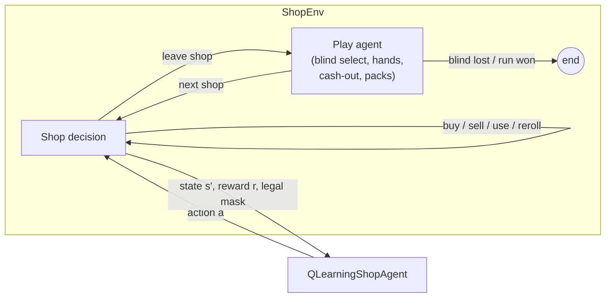
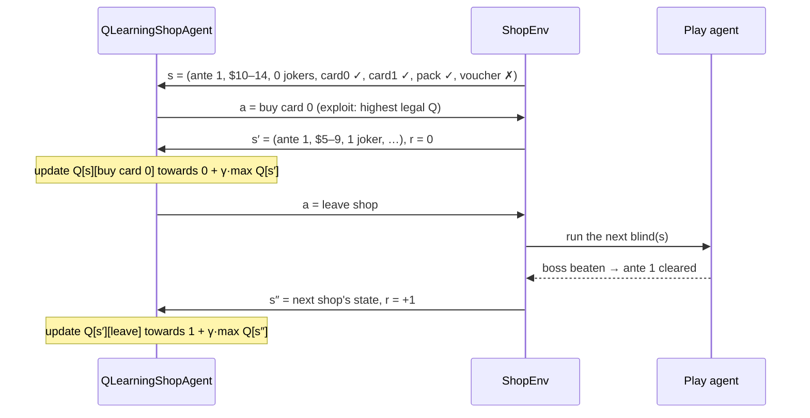
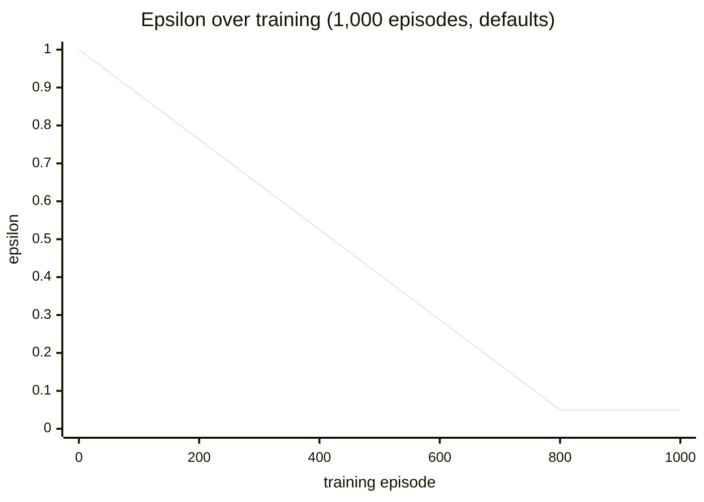

# Tabular Q-learning shop agent

`scripts/train_random_shop.py --shop qlearn` trains `QLearningShopAgent`, the first shop agent in
this fork that learns. It is deliberately simple: a lookup table of action values over a small,
hand-made description of the shop. That makes it quick to train and easy to inspect, and it gives
the deep Q-network that comes later a learning baseline to beat, not just the random one.

```bash
uv run python scripts/train_random_shop.py --shop qlearn --play smart \
    --episodes 1000 --eval-every 100 --eval-episodes 20 \
    --group qlearn_red --seed 0 --run-name qlearn_red_s0
```

## 1. Where the agent sits

The harness splits Balatro into two kinds of decisions. The **shop agent** makes every decision in
the shop. Everything else (choosing the blind, playing and discarding hands, cashing out, picking
cards from packs) is handled by a fixed **play agent** (`--play random` or Jackdaw's greedy
`smart_agent`). `ShopEnv` hides those other phases: one shop-agent step runs the game forward until
the next shop decision or the end of the run.



Only the shop agent learns. The play agent's behaviour is part of the environment, so results
depend on `--play`. Compare Q-learning against the random shop agent with the same `--play`.

## 2. The problem as an MDP

### State

Jackdaw's `global_context` vector (what the random agent is given) has 230 continuous features and
doesn't describe the shop's contents. A table needs a small, discrete state instead.
`tabular_state(gs, mask)` builds one with 7 numbers:

| # | Feature | Values | Why |
|---|---|---|---|
| 0 | ante | 1–8 (clipped) | how far into the run, and so how strong blinds are |
| 1 | money bracket | `dollars // 5`, clipped to 0–5 (0–4, 5–9, …, 25+) | interest is $1 per $5 held, capped at $25 by default |
| 2 | jokers held | 0–5 (clipped) | the main source of scoring power |
| 3 | can buy card 0 | 0/1 | in stock **and** affordable (from the legal mask) |
| 4 | can buy card 1 | 0/1 | 〃 |
| 5 | can buy a pack | 0/1 | either pack slot |
| 6 | can buy the voucher | 0/1 | 〃 |

That gives at most 8 × 6 × 6 × 2⁴ = **4,608 states**. Far fewer are ever reached: a 1,000-episode
run visits a few hundred. The table is a `dict` that only stores states the agent has been in.

### Actions

The 17 shop actions shared by every shop agent:

| Index | Action | Index | Action |
|---|---|---|---|
| 0, 1 | buy card in slot 0 / 1 | 11, 12 | sell consumable 0 / 1 |
| 2, 3 | buy (open) pack 0 / 1 | 13, 14 | use consumable 0 / 1 |
| 4 | buy voucher | 15 | reroll |
| 5–10 | sell joker 0–5 | 16 | leave shop |

At each decision the env supplies a **legal-action mask** (in stock, affordable, a free slot, …).
The agent only chooses among legal actions, and when it looks ahead it only considers the legal
actions of the next state. Leaving is always legal.

### Reward

The harness's existing ante reward: clearing ante *k* gives *k* (so clearing ante 1 → +1, ante
2 → +2, …). Everything else gives 0. The reward arrives on the step whose autoplay cleared the
boss blind, which is almost always a **leave shop** step, since leaving is what starts the next
round.

### Episode end

The run ends when a blind is lost (or the run is won). Nothing is bootstrapped beyond the end.

## 3. Q-learning in one page

*Q(s, a)* estimates the total discounted reward from taking action *a* in state *s* and acting well
afterwards. After every shop decision the agent sees *(s, a, r, s′, done)* and moves its estimate
towards a one-step **target**:

$$
\text{target} =
\begin{cases}
r & \text{if done} \\
r + \gamma \max\limits_{a' \in \text{legal}(s')} Q(s', a') & \text{otherwise}
\end{cases}
$$

$$
Q(s, a) \leftarrow Q(s, a) + \alpha\,\big(\text{target} - Q(s, a)\big)
$$

| Symbol | Flag | Default | Meaning |
|---|---|---|---|
| α | `--alpha` | 0.1 | learning rate: how far each update moves the estimate |
| γ | `--gamma` | 0.95 | discount: how much future reward counts against immediate reward |
| ε | `--eps-start`, `--eps-end`, `--eps-decay` | 1.0 → 0.05 over 80% of episodes | chance of a random legal action instead of the best known one |

Two details matter for this problem:

- **The max is over legal actions only.** An action that is illegal in *s′* (an empty slot, or
  too expensive) can't be taken there, so its value must not leak into the target.
- **Ties are broken at random.** The table starts at zero, so at first every action ties. Without
  random tie-breaking the agent would always pick the lowest index (buy card 0).

## 4. Pseudocode

### Training

```text
Q ← empty table (unseen states read as all zeros)
for episode = 0 .. N-1:
    ε ← eps_start + min(episode / decay_episodes, 1) · (eps_end − eps_start)
    s, mask ← env.reset()                      # play agent runs to the first shop
    while not done:
        legal ← indices where mask is true
        if random() < ε:  a ← uniform choice from legal              # explore
        else:             a ← random choice among argmax_{legal} Q[s]  # exploit
        s′, mask′, r, done ← env.step(a)       # play agent runs to the next shop, if any
        target ← r if done else r + γ · max_{a′ ∈ legal(mask′)} Q[s′][a′]
        Q[s][a] ← Q[s][a] + α · (target − Q[s][a])
        s, mask ← s′, mask′
save Q to runs/<name>/q_table.json
```

### Evaluation (every `--eval-every` episodes)

```text
for each fixed eval game (seed EVAL_i, deck, stake):
    s, mask ← eval_env.reset(seed, deck, stake)
    while not done:
        a ← random choice among argmax_{legal} Q[s]   # greedy: ε = 0, ties from eval RNG
        s, mask, _, done ← eval_env.step(a)          # no update: eval never learns
```

Eval has its own env, play agent and random number generators, so running it doesn't change the
training episodes. Every run with the same eval settings plays the same eval games.

## 5. One shop visit, step by step



## 6. A worked update

With the defaults α = 0.1 and γ = 0.95, say the agent is in state *s*, has estimated
*Q(s, buy card 0)* = 0.20, buys the card (reward 0), and the best legal action in the new state
*s′* is worth 0.50:

```text
target    = 0 + 0.95 × 0.50          = 0.475
TD error  = 0.475 − 0.20             = 0.275
Q(s, a)   = 0.20 + 0.1 × 0.275       = 0.2275
```

If that step had ended the run instead (`done`), the target would be just the reward, 0, and
*Q(s, a)* would fall to 0.18.

## 7. Exploration schedule

ε falls linearly from `--eps-start` to `--eps-end` over `--eps-decay × --episodes` training
episodes, then stays there. For 1,000 episodes with the defaults (decay over 800):

| Training episode | 0 | 200 | 400 | 600 | 800+ |
|---|---|---|---|---|---|
| ε | 1.00 | 0.76 | 0.53 | 0.29 | 0.05 |



The first stretch of training is almost a random shop agent. Expect the training curve to be flat
early on and then improve. The eval curve (always greedy) shows what the table has learned so far.

## 8. What gets written

On top of the usual run files:

- `config.json`: `shop_agent: "QLearningShopAgent"`, `shop: "qlearn"`, and `agent_params`
  (α, γ, ε settings and `eps_decay_episodes`).
- `q_table.json`: every visited state with its visit count and 17 Q-values, plus the action names.
  Useful for inspecting what was learned:

```python
import json
t = json.load(open("runs/qlearn_red_s0/q_table.json"))
names = t["action_names"]
for s in sorted(t["states"], key=lambda s: -s["visits"])[:5]:
    best = max(range(17), key=lambda a: s["q"][a])
    print(s["state"], s["visits"], "→", names[best])
```

## 9. Reading the results in the dashboard

Train three seeds per config with `--group`, then select the groups in balatro-run-analysis:

- **Overview → Evaluation on fixed seeds**: `qlearn_red` against `smart_red` (same play agent,
  random shop) on identical eval games. This is the main result.
- **Overview → Groups**: the group comparison table gives the difference in mean ante with a
  Welch's t CI across seeds.
- **Actions → Over training**: a random agent's action mix stays flat; a learning one should shift.
- **Actions → Availability**: a preference above 1 shows the actions the agent favours over random choice.

### Sample results

Three seeds × 1,000 episodes with `--play smart` on the Red Deck at stake 1. Each run visited
360–390 states.

| Group (3 seeds) | Shop agent | Training mean ante | Δ vs `smart_red` [95% CI] |
|---|---|---|---|
| `smart_red` | random | 1.42 | (baseline) |
| `qlearn_red` | Q-learning | 1.57 | +0.15 [0.11, 0.19], p = 0.001 |

What the tables learned in the most-visited states (seed 1):

| State (ante, $ bracket, jokers, card0, card1, pack, voucher) | Visits | Best actions (Q) |
|---|---|---|
| (1, $5–9, 0, ✓, ✓, ✓, ✗) | 937 | buy card 1 (0.56), buy card 0 (0.41), buy pack 1 (0.37) |
| (1, $0–4, 1, ✗, ✗, ✗, ✗) | 584 | leave (0.60), sell joker 0 (0.37) |
| (2, $0–4, 2, ✗, ✗, ✗, ✗) | 386 | leave (0.51), sell joker 1 (0.14) |

So it learns to buy a joker early when it can afford one, and to leave when it's broke. That's a
sensible start, but eval on 20 fixed games is noisy: one seed rose from 1.50 to 2.05 mean ante
while the others barely moved. Use more eval games and more seeds before drawing conclusions.

## 10. Limitations and next steps

- **Reward lands on "leave shop".** The ante reward arrives on the step that starts the next round,
  so leaving collects all of it directly. Buying only earns value through the discounted look-ahead
  (γ · max Q(s′)), and only if having more jokers or less money leads to states that are worth more.
  The agent can learn that leaving at once is "good enough", and early tables often rank *leave*
  highest. Reward shaping (e.g. rewarding beaten blinds or score margin) or a γ closer to 1 helps.
- **The state is coarse.** The agent sees *whether* it can buy card 0, not *what* card 0 is. It
  cannot prefer a strong joker over a weak one, and it can't tell which joker to sell. This is the
  main reason to move to a deep Q-network over a richer state (item identities, joker build, shop prices).
- **Sparse reward, few visits.** Most runs end in ante 1–2, so states in later antes are rarely seen
  and their values stay close to zero.
- **Non-stationarity from the play agent.** `--play smart` is greedy but fixed. A better play agent
  changes which shop decisions pay off, so learned tables don't transfer between `--play` settings.

Next steps, roughly in order: reward shaping → richer discrete features (rarity of the card in each
slot, the interest-cap gap) → a DQN with experience replay and a target network over the full state,
using the same `act` / `observe` interface.
